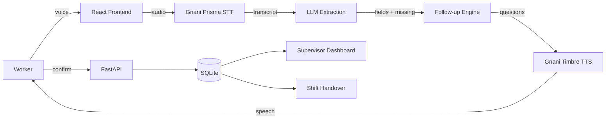

# ShiftSathi — Voice-First Industrial Intelligence Assistant

   

ShiftSathi lets factory workers report machine problems by voice. It transcribes speech (Hindi/English/Hinglish) using Gnani Prisma, extracts structured incident fields with an LLM, asks intelligent follow-up questions, reads back a confirmation using Gnani Timbre, and generates a professional incident report plus shift handover. A supervisor dashboard provides analytics and history.

## Architecture



## Features
- Voice recording + audio upload
- Gnani Prisma STT (code-mixed Hinglish)
- Gnani Timbre TTS read-back
- LLM structured extraction + missing-field detection + follow-up questions
- Human confirmation before final report
- Incident history with search/filter
- Supervisor dashboard (Recharts)
- Shift handover summary
- Evaluation harness with metrics

## Tech Stack
- Frontend: React + Vite + Tailwind CSS + Lucide + Recharts
- Backend: FastAPI + Uvicorn + SQLAlchemy + SQLite
- AI: Gnani Prisma (STT), Gnani Timbre (TTS), OpenAI-compatible LLM (optional; heuristic fallback)

## Setup

### Backend
```bash
cd backend
python -m venv .venv
# activate
pip install -r requirements.txt
copy .env.example .env
# fill GNANI_API_KEY_ID (and LLM_API_KEY if available)
python -m uvicorn app.main:app --host 0.0.0.0 --port 8000 --reload
```

### Frontend
```bash
cd frontend
npm install
npm run dev
```
Open http://localhost:5173

## Environment Variables
See `backend/.env.example`. Never commit real keys.

## API Endpoints
- `POST /api/voice/transcribe` — multipart audio -> transcript
- `POST /api/voice/tts` — {text} -> base64 audio
- `POST /api/extract` — {transcript} -> extracted fields
- `POST /api/sessions/start` — start conversation
- `POST /api/sessions/{id}/answer` — answer follow-up
- `POST /api/sessions/{id}/confirm` — finalize incident
- `GET /api/incidents` — list/filter
- `GET /api/dashboard/stats`
- `GET /api/handover`
- `POST /api/eval/run`

## Gnani Integration Notes
- STT: POST `https://api.vachana.ai/stt/v3` multipart with `audio_file`, fields `language_code`, `preferred_language`, `format=transcribe`, `itn_native_numerals=true`, header `X-API-Key-ID`.
- TTS: POST `https://api.vachana.ai/api/v1/tts/sse` JSON `{audio_config, model, text, voice}`, header `X-API-Key-ID`. Response is SSE with base64 audio chunks.

## Verification Status
- Backend tests: 13/13 passing
- Frontend build: passing
- Evaluation: 50 scenarios, 91.3% field accuracy (heuristic fallback)
- Gnani Prisma/Timbre: integrated per official docs; **live API not verified** (no credentials in this environment)
- Public deployment: not deployed; Docker config provided

## Safety
AI never controls machinery. Reports require human confirmation. Missing info is flagged, never guessed.

## Solution Pitch
A one-page solution pitch is available in [SOLUTION_PITCH.md](./SOLUTION_PITCH.md).

## Author & Contribution

This project was designed and implemented individually by **Anika** ([@anikak206](https://github.com/anikak206)) for the Gnani AI Great Indian AI Internship Challenge 2026. All code, documentation, tests, and evaluation were authored by the contributor.
